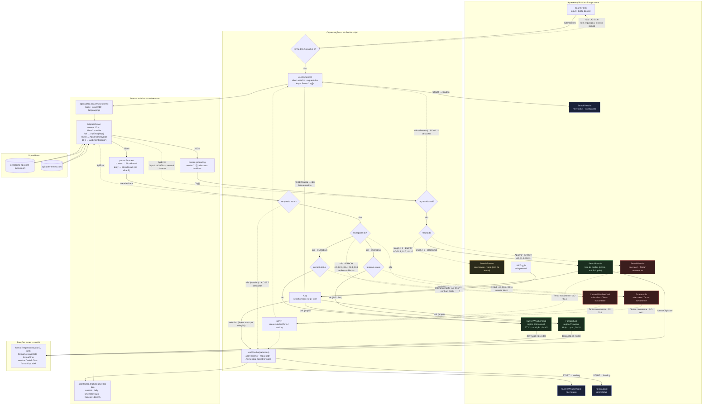

# Weather App — Plano Técnico

> Versão 1.0 — 27/10/2026. Deriva de
> [`specs/weather-app-spec.md`](../specs/weather-app-spec.md) v1.0. Cada
> decisão cita os requisitos (RF/RNF) ou critérios (AC) que a motivam. Alimenta
> `tasks/weather-app-tasks.md`.

## 1. Architecture Overview

SPA estática em React, sem backend próprio (RF-06), consumindo a Open-Meteo
diretamente do navegador (RF-05). Quatro camadas finas, com dependências em
**um único sentido** (de cima para baixo) e tipos compartilhados em
`src/types/`:

```text
┌─────────────────────────────────────────────────────────────────┐
│ Apresentação (src/components)                                   │
│  Header[UnitToggle] · SearchForm · SearchResults                │
│  CurrentWeatherCard · ForecastList[ForecastDayCard]             │
│  StatusMessage (status) · ErrorMessage (alert + retry) · Footer │
│  → recebe dados prontos por props; emite eventos                │
├─────────────────────────────────────────────────────────────────┤
│ Orquestração e estado (src/hooks + App)                         │
│  useCitySearch()  →  AsyncState<City[]>                         │
│  useWeather()     →  AsyncState<WeatherData>                    │
│  App: unit (useState) + selection {city, seq} (useState)        │
│  → decide QUANDO buscar, cancela, descarta obsoletos, retry     │
├─────────────────────────────────────────────────────────────────┤
│ Acesso a dados (src/services)                                   │
│  openMeteo.searchCities() · openMeteo.fetchWeather()            │
│  http.fetchJson() — timeout 10 s, abort, ApiError               │
│  → única camada que conhece URLs, JSON bruto e fetch            │
├─────────────────────────────────────────────────────────────────┤
│ Funções puras (src/lib)                                         │
│  temperature · dates · weatherCode · cityLabel                  │
│  → sem React, sem I/O, sem Date.now(); entrada → saída          │
└─────────────────────────────────────────────────────────────────┘
          │                                   │
          ▼                                   ▼
 geocoding-api.open-meteo.com         api.open-meteo.com
```

### Responsabilidades e regras de dependência

| Camada | Responde a | Pode importar | **Não pode** | Rastreio |
|---|---|---|---|---|
| **components** | *Como* mostrar um estado já resolvido. Renderiza `AsyncState`/`BlockResult` em `role`s corretos; chama `lib/` para formatar; emite `onSubmit`, `onSelect`, `onRetry`, `onChangeUnit`. | `lib`, `types`, `i18n`, outros components | `services`, `fetch`, `useEffect` com I/O, `localStorage` | AC-01.0–01.3, 02.1, 03.1, 04.4 (roles e textos) |
| **hooks** | *Quando* e *com que argumentos* buscar; ciclo de vida da requisição (abort, `requestId`, timeout via services, retry); transições do `AsyncState`. | `services`, `types` | `components`, JSX, `lib` de formatação, URLs | AC-01.4a/b, 01.12, 02.7, 00.1 (estados e corridas) |
| **services** | *De onde* vêm os dados e *em que forma* chegam. Monta URL, chama `fetchJson`, valida o DTO e devolve tipos de domínio ou `ApiError`. | `types`, `services/http` | React, `lib` de formatação, estado | AC-05.x, 01.8, 01.10, 02.5, 03.7 (parsers) |
| **lib** | Transformações determinísticas: °C→°F + arredondamento, data civil → rótulo, WMO → texto, `City` → rótulo. | `types`, `i18n` | tudo o mais; nenhum `Date.now()`, nenhum `Math.random()` | AC-02.8, 02.9, 03.9, 03.10, 04.2, 04.5, 01.16 |
| **types** | Contratos (§4). Só tipos e a classe `ApiError`. | — | qualquer módulo com lógica | §4 |
| **i18n** | Strings pt-BR (Apêndice C). Objeto constante. | — | — | RNF-09 |

Enforço mecânico opcional (sem nova dependência): `style/noRestrictedImports`
do Biome aplicada via `overrides` por pasta em `biome.json` — em
`src/components/**` proibir `../services/*`; em `src/lib/**` e
`src/services/**` proibir `react`. Se o custo de manutenção parecer alto para
6 componentes, a revisão de código cumpre o papel.

### Por que separar assim

1. **Cada AC da spec cai em exatamente uma camada.** Critérios de formato
   (AC-04.5 `"-0.4 → 0°C"`) são testes de `lib`; critérios de corrida
   (AC-01.12) são testes de `hooks`; critérios de forma de resposta
   (AC-01.10 `{}` vs `results: []`) são testes de `services`; critérios de
   `role` (AC-02.1 `region "Clima atual"`) são testes de `components`. Não há
   AC que exija montar a árvore inteira para ser verificado — exceto os E2E,
   que é o propósito deles.
2. **A fronteira de rede é um único módulo.** `vi.mock('services/openMeteo')`
   substitui toda a I/O em testes de hooks e componentes; `page.route` nos
   dois hosts faz o mesmo no E2E. Nenhum teste precisa saber de `fetch`.
3. **Falhas de conteúdo e de transporte vivem em lugares diferentes.**
   `services` decide `BlockResult.invalid` (conteúdo); `hooks` decide
   `AsyncState.error` (transporte). Isso espelha o Modelo de requisições da
   spec e evita que componentes façam `try/catch` ou verifiquem `undefined`
   (AC-00.2).
4. **Componentes são funções de props.** Sem efeitos, qualquer estado é
   reproduzível passando um `AsyncState` literal — inclusive os raros
   (`timeout`, `invalid` em um bloco só), que seriam difíceis de provocar via
   rede real.
5. **Funções puras não dependem de relógio nem de fuso.** "Hoje" é a
   primeira entrada de `daily.time`, não `Date.now()`; datas são strings
   civis. Os testes de `lib` rodam idênticos em qualquer máquina e TZ
   (AC-03.9).

### Como isso mapeia para a pirâmide de testes

| Camada | Nível | Ferramenta | Isolamento | Velocidade |
|---|---|---|---|---|
| `lib` | Unitário puro | Vitest | nenhum mock | ms |
| `services` | Unitário com I/O simulada | Vitest, `vi.fn()` em `globalThis.fetch`, fake timers para timeout | mock de `fetch` | ms |
| `hooks` | Componente (lógica) | Vitest + `renderHook`, `vi.mock` do service | mock de `services` | ms |
| `components` | Componente (render) | Vitest + Testing Library, props literais | nenhum mock necessário | ms |
| `App` | Integração sem navegador | Testing Library + `vi.mock` do service | mock de `services` | dezenas de ms |
| fluxo completo | E2E | Playwright + `page.route` + fixtures §6.3 | mock de rede no navegador | segundos |

A maior parte dos 58 critérios é verificável nos quatro primeiros níveis;
o E2E fica reservado ao que só o navegador prova: rede real interceptada
(AC-05.x, AC-06.2), foco e teclado (AC-01.14), fuso do navegador (AC-03.9),
reload (AC-04.6), viewport (RNF-01), axe (RNF-05).

### Princípios transversais

- **Três blocos independentes na UI** (busca, clima atual, previsão), cada um
  com estados próprios de carregamento/vazio/erro (Edge Cases, "degradar por
  bloco"). Clima atual e previsão compartilham **uma** requisição
  (Modelo de requisições da spec); a independência é de *conteúdo*, não de
  transporte.
- **Estado em memória apenas** (RF-06, AC-04.6, AC-06.3). Sem router, sem
  storage, sem contexto global além de props.

## 2. Tech Stack

Tudo já presente em `package.json`, salvo onde indicado.

| Camada | Escolha | Versão | Justificativa / rastreio |
|---|---|---|---|
| Linguagem | TypeScript `strict` | 6.0 | Convenção do projeto; contratos de dados (§4) verificados em compile-time. |
| UI | React | 19.2 | Convenção. Componentes funcionais + hooks (instruções React). |
| Build/dev | Vite | 8.0 | Convenção; `base` já configurado para GitHub Pages (Ship). |
| Estilo | Tailwind CSS | 3.4 | Convenção; paleta `night/accent/sun` já em `tailwind.config.js` (Estrutura da interface). |
| Fonte tipográfica | `@fontsource/inter` **(nova devDependency)** | pinar a versão estável no momento da tarefa (padrão do repositório: versões exatas) | `index.html` hoje carrega Google Fonts, o que viola a allowlist de AC-06.2. Self-host resolve sem perder o design. |
| Lint/format | Biome | 2.5 | Convenção (`pnpm lint`, `pnpm check`). |
| Testes unitários | Vitest + Testing Library + jsdom | 4.1 / 16.3 | Convenção; `vitest.config` já aponta `tests/unit/**` e `tests/setup.ts`. |
| Testes E2E | Playwright | 1.61 | Convenção; projetos `chromium` e `mobile` já configurados. |
| Acessibilidade automatizada | `@axe-core/playwright` **(nova devDependency)** | pinar a versão estável no momento da tarefa | RNF-05 exige zero violações `serious`/`critical` em 4 telas. |
| Estado | `useState`/`useReducer` nativos | — | Dois recursos assíncronos e dois valores simples não justificam biblioteca (Risks §10). |
| Rede | `fetch` nativo + `AbortController` | — | Sem axios/TanStack Query: a spec exige apenas timeout, cancelamento e retry manual (AC-00.1, AC-01.11, AC-01.12). |
| Mock de rede | `vi.mock` (unit) + `page.route` (E2E) | — | Instruções de teste do projeto; evita MSW como dependência extra. |

Não adotados deliberadamente: React Router (Out of Scope: URL fixa), Zustand/
Redux, TanStack Query, MSW, biblioteca de ícones (Out of Scope: condição é
texto), date-fns (datas são strings civis simples — §4, §5).

## 3. Project Structure

```text
src/
  main.tsx                    # bootstrap React 19 (createRoot, StrictMode)
  App.tsx                     # composição dos blocos; dono de unit e selection
  index.css                   # @tailwind base/components/utilities + import da fonte
  components/
    Header.tsx                # h1 "Previsão do Tempo" + UnitToggle          (Estrutura §1)
    UnitToggle.tsx            # 2 botões aria-pressed                        (AC-04.4)
    SearchForm.tsx            # label "Cidade", input, botão "Buscar"        (AC-01.0, 01.6, 01.17)
    SearchResults.tsx         # lista de botões; estados status/alert        (AC-01.1–01.5, 01.14–01.16, 01.18)
    CurrentWeatherCard.tsx    # region "Clima atual"                         (AC-02.1, 02.8, 02.9)
    ForecastList.tsx          # region "Previsão", grid responsivo           (AC-03.1, 03.10)
    ForecastDayCard.tsx       # uma entrada diária                           (AC-03.2)
    StatusMessage.tsx         # role="status" para loading e vazio           (Glossário)
    ErrorMessage.tsx          # role="alert" + botão "Tentar novamente"      (AC-00.1)
    Footer.tsx                # atribuição Open-Meteo com link               (AC-05.4)
  hooks/
    useCitySearch.ts          # busca: AsyncState<City[]>, abort, retry      (RF-01)
    useWeather.ts             # clima+previsão: AsyncState<WeatherData>      (RF-02, RF-03)
  services/
    http.ts                   # fetchJson com timeout/abort → ApiError       (AC-01.11, 02.4, 03.6)
    openMeteo.ts              # searchCities, fetchWeather, parsers          (Apêndice A)
    openMeteo.types.ts        # DTOs brutos da API, nunca saem de services   (§4)
  lib/
    temperature.ts            # toUnit, roundHalfUp, formatTemperature       (AC-04.2, 04.5)
    dates.ts                  # formatForecastDate, formatTime               (AC-02.8, 03.9, 03.10)
    weatherCode.ts            # WMO → chave de texto                         (Apêndice B)
    cityLabel.ts              # formatCityLabel: "Nome, Admin1, País"        (AC-01.1, 01.16)
  i18n/
    strings.ts                # pt-BR, chaves do Apêndice C                  (RNF-09)
  types/
    weather.ts                # City, CurrentWeather, ForecastDay, …         (§4)
    async.ts                  # AsyncState, ApiError, BlockResult            (§4)

tests/
  setup.ts                    # @testing-library/jest-dom
  unit/
    lib/                      # temperature, dates, weatherCode (U)
    services/                 # openMeteo parsers com fetch mockado (U)
    hooks/                    # useCitySearch, useWeather com services mockados (C)
    components/               # cada componente, estados e a11y básica (C)
  e2e/
    fixtures/                 # JSON: geocoding-*.json, forecast-*.json
    helpers/                  # routeOpenMeteo(page, overrides), collectRequests(page)
    search.spec.ts            # US-01, US-06
    weather.spec.ts           # US-02, US-03
    unit-toggle.spec.ts       # US-04
    resilience.spec.ts        # US-05
    constraints.spec.ts       # RF-05, RF-06 (hosts, storage, atribuição)
    a11y.spec.ts              # RNF-05 (axe em 4 telas, fluxo só-teclado)
    responsive.spec.ts        # RNF-01 (3 viewports, scrollWidth)
```

Regras: um componente por arquivo com `export default`; efeitos só em hooks e
services; dependências apenas no sentido `components → hooks → services`,
com `lib`, `types` e `i18n` como folhas (tabela de regras em §1). A estrutura
de `tests/unit/` espelha `src/` para que cada módulo tenha um teste homônimo
(`src/lib/dates.ts` ↔ `tests/unit/lib/dates.test.ts`).

## 4. Data Model

Contratos TypeScript (sem implementação). Duas famílias de tipos, com
fronteira clara em `services/openMeteo.ts`:

- **DTOs brutos** (`OpenMeteo*`): espelham o JSON da API, tudo opcional,
  nunca saem da camada de services.
- **Tipos de domínio** (`City`, `CurrentWeather`, `ForecastDay`,
  `WeatherData`, `Unit`): já validados e normalizados; é o que hooks e
  componentes consomem. Temperaturas ficam em **°C bruto**; conversão e
  arredondamento acontecem apenas na formatação (AC-04.7).

### Tipos de domínio

```ts
// src/types/weather.ts

/** Unidade de exibição. Nunca persistida (AC-04.6); inicial 'celsius' (AC-04.1). */
export type Unit = 'celsius' | 'fahrenheit';

/** Cidade resultante da geocodificação, já normalizada. */
export interface City {
  /** Identificador estável da Open-Meteo (GeoNames). Usado como `key` na lista. */
  id: number;
  /** Nome localizado (language=pt). Exibido sempre. */
  name: string;
  /** Coordenadas em graus decimais; enviadas na requisição de previsão (AC-05.2). */
  latitude: number;
  longitude: number;
  /** Divisão administrativa de 1º nível (estado/província). Ausente em alguns locais (AC-01.16). */
  admin1?: string;
  /** Nome do país localizado. Ausente em raros casos (ex.: Antártida). */
  country?: string;
}

/** Condições no momento da resposta. */
export interface CurrentWeather {
  /** "YYYY-MM-DDTHH:mm" no fuso da cidade (timezone=auto). Só a parte HH:mm é exibida (AC-02.8). */
  time: string;
  /** Temperatura do ar a 2 m, em °C, sem arredondar. */
  temperatureC: number;
  /** Código WMO (Apêndice B). `null` quando ausente na resposta → condição omitida (AC-02.6). */
  weatherCode: number | null;
}

/** Uma entrada da previsão diária. */
export interface ForecastDay {
  /** Data civil "YYYY-MM-DD" no fuso da cidade. Nunca converter via `new Date(iso)` (AC-03.9). */
  date: string;
  /** Máxima e mínima do dia a 2 m, em °C, sem arredondar. */
  maxC: number;
  minC: number;
  /** Código WMO do dia. `null` quando ausente. */
  weatherCode: number | null;
}

/**
 * Resultado da requisição única de previsão, avaliado por bloco
 * (Modelo de requisições da spec). Falhas de transporte nunca chegam aqui —
 * viram `ApiError`. Falhas de conteúdo viram `invalid` só no bloco afetado.
 */
export interface WeatherData {
  /** Bloco "Clima atual". `invalid` se faltar temperatura ou `time` (AC-02.5). */
  current: BlockResult<CurrentWeather>;
  /** Bloco "Previsão": 1 a 5 itens, em ordem cronológica. `invalid` se arrays desalinhados ou vazios (AC-03.7, AC-03.11). */
  forecast: BlockResult<ForecastDay[]>;
}
```

```ts
// src/types/async.ts

/** Falha de transporte: afeta todos os blocos da requisição. */
export type ApiErrorKind = 'http' | 'network' | 'timeout' | 'aborted';

export class ApiError extends Error {
  readonly kind: ApiErrorKind;
  /** Presente quando kind === 'http' (inclui 429 de rate limit). */
  readonly status?: number;
}

/** Falha de conteúdo: afeta só o bloco (AC-02.5, AC-03.7, AC-03.11). */
export type BlockResult<T> =
  | { status: 'ok'; data: T }
  | { status: 'invalid'; reason: string };

/** Máquina de estados de um recurso assíncrono. */
export type AsyncState<T> =
  | { status: 'idle' }
  | { status: 'loading' }
  | { status: 'success'; data: T }
  | { status: 'empty' }                       // só usado pela busca (AC-01.3, AC-01.10)
  | { status: 'error'; error: ApiError };
```

### DTOs brutos da Open-Meteo

Tudo opcional: o parser decide o que é obrigatório. Campos que a API devolve
mas a v1 não consome estão listados em comentário para registro, não como
propriedades — evita a tentação de usá-los sem requisito.

```ts
// src/services/openMeteo.types.ts

/** GET geocoding-api.open-meteo.com/v1/search — a chave `results` é omitida quando não há correspondência (AC-01.10). */
export interface OpenMeteoGeocodingResponse {
  results?: OpenMeteoGeocodingResult[];
  // ignorado: generationtime_ms
}

export interface OpenMeteoGeocodingResult {
  id?: number;
  name?: string;
  latitude?: number;
  longitude?: number;
  country?: string;
  admin1?: string;
  // ignorados na v1: elevation, feature_code, country_code, country_id,
  //   admin2, admin3, admin4, timezone, population, postcodes
}

/** GET api.open-meteo.com/v1/forecast com current=temperature_2m,weather_code e daily=temperature_2m_max,temperature_2m_min,weather_code. */
export interface OpenMeteoForecastResponse {
  current?: {
    time?: string;             // "YYYY-MM-DDTHH:mm" local (timezone=auto)
    temperature_2m?: number;   // °C (unidade padrão da API)
    weather_code?: number;
    // ignorado: interval
  };
  daily?: {
    time?: string[];                  // "YYYY-MM-DD"
    temperature_2m_max?: number[];
    temperature_2m_min?: number[];
    weather_code?: number[];
  };
  // ignorados na v1: latitude, longitude, elevation, timezone,
  //   timezone_abbreviation, utc_offset_seconds, generationtime_ms,
  //   current_units, daily_units
}
```

Regras do parser (`services/openMeteo.ts`), rastreáveis aos ACs:

| DTO → domínio | Regra | Critério |
|---|---|---|
| `OpenMeteoGeocodingResult` → `City` | descartar item se `id`, `name`, `latitude` ou `longitude` faltarem ou não forem numéricos/strings; copiar `admin1`/`country` apenas se forem strings não vazias | AC-01.1, AC-01.16 |
| `results` ausente | tratar como `[]` → estado `empty` | AC-01.10 |
| `current` → `BlockResult<CurrentWeather>` | `invalid` se `temperature_2m` não for número finito ou `time` não for string; `weather_code` não numérico → `null` | AC-02.5, AC-02.6 |
| `daily` → `BlockResult<ForecastDay[]>` | `invalid` se qualquer um dos 4 arrays faltar, se os comprimentos diferirem ou se `time.length === 0`; caso contrário zipar índice a índice e `slice(0, 5)` | AC-03.7, AC-03.8, AC-03.11 |

Formato de exibição derivado (não armazenado):

| Função pura | Entrada → Saída | Critérios |
|---|---|---|
| `formatTemperature(valueC, unit)` | `21.3, 'celsius'` → `"21°C"`; `21.3, 'fahrenheit'` → `"70°F"`; `-0.4` → `"0°C"`; `-3.7` → `"-4°C"` | AC-04.2, AC-04.5 |
| `formatForecastDate(date, isFirst)` | `"2026-10-27", true` → `"Hoje"`; `"2026-10-28", false` → `"qua., 28/10"` | AC-03.10 |
| `formatTime(isoLocal)` | `"2026-10-27T14:45"` → `"14:45"` (substring; sem `Date`) | AC-02.8 |
| `weatherCodeToText(code)` | `61` → `"Chuva fraca"`; `999` → `"Condição desconhecida"` | AC-02.9, Apêndice B |
| `formatCityLabel(city)` | `{name, admin1?, country?}` → `"Londrina, Paraná, Brasil"` (omite ausentes) | AC-01.1, AC-01.16 |

Arredondamento: `Math.round` tem semântica "meio para cima" para positivos e
"meio para o par mais próximo de +∞" para negativos (`Math.round(-2.5) === -2`).
A spec exige "meio para cima" apenas nos exemplos positivos; adotar
`Math.round` e normalizar `-0` para `0` (`value === 0 ? 0 : value`).

## 5. Data Flow

### Visão geral

Caminhos sólidos são o fluxo feliz; tracejados são vazio, erro e descarte.
Losangos são decisões tomadas na camada indicada pelo subgrafo.



Leitura rápida do diagrama:

- **Dois `requestId`s independentes** (G2, G4): cada recurso descarta a própria
  resposta obsoleta; o `RESET` da busca ao selecionar não interfere no
  `useWeather`.
- **Erro de transporte (G5 "não") atinge os dois blocos**; erro de conteúdo
  (G6/G7 "invalid") atinge um só — é a representação visual do Modelo de
  requisições da spec.
- **`retry()` é um nó único** alimentado pelos três `alert`s, mas reexecuta o
  recurso certo (`lastTerm` ou `lastCity`).
- **A alternância de unidade nunca entra nos subgrafos de serviços ou
  externo** — vai de `UnitToggle` a `App` e desce por props até as funções
  puras.

### Busca (RF-01)

```text
SearchForm.onSubmit(term)
  └─ term.trim().length < 2 → return (AC-01.6; foco permanece)
  └─ useCitySearch.search(term)
       ├─ abort(controller anterior)                      (AC-01.12)
       ├─ state = loading                                 (AC-01.4a)
       └─ services.searchCities(term, signal)
            ├─ ok, results.length > 0 → success(City[])   (AC-01.1)
            ├─ ok, results ausente ou []  → empty         (AC-01.3, 01.10)
            ├─ ApiError 'aborted'         → ignorar       (resposta obsoleta)
            └─ ApiError outro             → error         (AC-01.5, 01.11)
SearchResults renderiza conforme state; blocos de clima não são tocados (AC-01.19)
```

### Seleção e previsão (RF-02, RF-03)

```text
SearchResults.onSelect(city)
  └─ App.setSelection({ city, seq: seq + 1 })   objeto novo a cada seleção,
  │                                              mesmo para a mesma cidade (AC-01.20)
  └─ useCitySearch.reset()                       (lista removida — AC-01.2)
  └─ foco → <section role="region"> "Clima atual" (AC-01.14)
useWeather(selection)            (useEffect em [selection])
  ├─ abort(anterior); requestId++; state = loading        (AC-02.2, 03.3, 02.7)
  └─ services.fetchWeather(lat, lon, signal)
       ├─ ApiError 'aborted' → ignorar
       ├─ ApiError outro     → error  (ambos os blocos)   (AC-02.3, 03.4, 02.4, 03.6)
       └─ ok → success(WeatherData)
             ├─ current.status === 'invalid'  → CurrentWeatherCard mostra ErrorMessage (AC-02.5)
             └─ forecast.status === 'invalid' → ForecastList mostra ErrorMessage      (AC-03.5, 03.7, 03.11)
```

Por que `{ city, seq }` e não `City`: `useState` ignora `set` com valor
`Object.is`-igual, e `useEffect` só reexecuta quando a dependência muda. Um
contador embutido garante um objeto novo por seleção sem expor `requestId`
(que é detalhe interno do hook, em `useRef`) para fora.

### Unidade (RF-04)

```text
UnitToggle.onChange(unit) → App.setUnit(unit)
  └─ re-render; formatTemperature(valueC, unit) em cada card   (AC-04.2, 04.3)
  └─ nenhum fetch (AC-04.7); nenhum storage (AC-04.6)
```

### Retry (AC-00.1)

Cada hook expõe `retry()` que reexecuta a última chamada com os mesmos
argumentos. `ErrorMessage` recebe `onRetry`; após o clique, o foco vai para o
**wrapper do bloco** (ver abaixo), nunca para o `StatusMessage` — que
desmontaria ao chegar a resposta e deixaria o foco cair no `body`.

### Wrapper persistente de bloco (AC-01.14, AC-00.1, AC-02.1)

`CurrentWeatherCard` e `ForecastList` renderizam **sempre** o mesmo
contêiner, independentemente do estado:

```text
<section role="region" aria-labelledby="current-heading" tabIndex={-1} ref>
  <h2 id="current-heading">Clima atual</h2>
  {status | alert | conteúdo}
</section>
```

- O contêiner monta na primeira seleção (AC-01.0: ausente antes) e nunca
  desmonta enquanto houver `selection`.
- `tabIndex={-1}` torna-o focável programaticamente sem entrar na ordem de
  tabulação.
- O nome acessível vem do `h2` via `aria-labelledby`; os testes localizam por
  `getByRole('region', { name: 'Clima atual' })` em qualquer estado.
- `App` guarda um `ref` para a `region` "Clima atual" e chama `focus()` após
  `onSelect` e após `onRetry` de qualquer bloco.

### Identidade da requisição (StrictMode e corridas)

`useWeather` e `useCitySearch` mantêm um `requestId` incremental em `useRef`;
a resposta só é aplicada se `id === latestId`. Isso cobre AC-01.12/AC-02.7
mesmo quando o `abort()` não chega antes da resposta e torna o efeito
idempotente sob o duplo-mount do React 19 StrictMode em desenvolvimento.

## 6. External APIs

Fonte: Apêndice A da spec. A camada `services/openMeteo.ts` monta as URLs e
**valida a forma** da resposta antes de devolver tipos de §4. Os exemplos
abaixo são a base dos fixtures em `tests/e2e/fixtures/` e dos mocks unitários.
Nenhum endpoint exige API key (AC-05.3); ambos aceitam CORS de qualquer origem.

### 6.1 Geocodificação — `searchCities(term)`

**URL**

```text
GET https://geocoding-api.open-meteo.com/v1/search
    ?name={term}&count=10&language=pt&format=json
```

**Parâmetros**

| Parâmetro | Valor | Motivo |
|---|---|---|
| `name` | termo após `trim()`, via `encodeURIComponent` | AC-01.8 (acentos e pontuação preservados). A API exige ≥ 2 caracteres: com 1 caractere devolve vazio; com 2 faz correspondência exata; com ≥ 3 faz busca aproximada — por isso AC-01.6 bloqueia < 2. |
| `count` | `10` | Limite da lista (AC-01.18). Máximo aceito pela API: 100. |
| `language` | `pt` | `name`, `country` e `admin1` localizados (RNF-09). |
| `format` | `json` | Padrão explícito. |

**Exemplo de resposta (resumido)** — `GET …?name=Londrina&count=10&language=pt&format=json`

```json
{
  "results": [
    {
      "id": 3458449,
      "name": "Londrina",
      "latitude": -23.31028,
      "longitude": -51.16278,
      "country": "Brasil",
      "admin1": "Paraná",
      "country_code": "BR",
      "timezone": "America/Sao_Paulo",
      "population": 506645
    }
  ],
  "generationtime_ms": 0.63
}
```

Sem correspondência (`?name=Xyzabc`), a API devolve **sem a chave `results`**:

```json
{ "generationtime_ms": 0.41 }
```

Resultado sem `admin1` (ex.: cidades-estado) ou sem `country` (ex.: Antártida)
simplesmente omite a chave.

**Mapeamento → `City`**

| JSON | `City` | Regra |
|---|---|---|
| `results[i].id` | `id` | obrigatório, `number` |
| `results[i].name` | `name` | obrigatório, `string` não vazia |
| `results[i].latitude` | `latitude` | obrigatório, `number` finito |
| `results[i].longitude` | `longitude` | obrigatório, `number` finito |
| `results[i].admin1` | `admin1?` | copiado se `string` não vazia (AC-01.16) |
| `results[i].country` | `country?` | copiado se `string` não vazia (AC-01.16) |
| `results` ausente ou `[]` | — | `[]` → estado `empty` (AC-01.3, AC-01.10) |
| item sem campo obrigatório | — | descartado silenciosamente |
| demais chaves | — | ignoradas |

### 6.2 Previsão — `fetchWeather(latitude, longitude)`

**URL**

```text
GET https://api.open-meteo.com/v1/forecast
    ?latitude={lat}&longitude={lon}
    &current=temperature_2m,weather_code
    &daily=temperature_2m_max,temperature_2m_min,weather_code
    &timezone=auto
    &forecast_days=5
```

**Parâmetros**

| Parâmetro | Valor | Motivo |
|---|---|---|
| `latitude`, `longitude` | do `City` selecionado, sem arredondar | AC-05.2, AC-01.15 |
| `current` | `temperature_2m,weather_code` | Conteúdo mínimo do clima atual (RF-02). `time` vem sempre, sem pedir. |
| `daily` | `temperature_2m_max,temperature_2m_min,weather_code` | Conteúdo mínimo da previsão (RF-03). `time` vem sempre. |
| `timezone` | `auto` | Datas e horas no fuso da cidade (RF-05, AC-02.8, AC-03.1). Sem isso a API usa GMT e "hoje" pode ser o dia errado. |
| `forecast_days` | `5` | D a D+4 (AC-03.1). Reduz payload; o parser ainda corta em 5 por segurança (AC-03.8). |
| `temperature_unit` | **omitido** (padrão `celsius`) | Conversão é local (AC-04.7); pedir °F à API quebraria AC-04.7 e dobraria requisições. |

**Exemplo de resposta (resumido)** — Londrina, 27/10/2026

```json
{
  "latitude": -23.3125,
  "longitude": -51.1875,
  "timezone": "America/Sao_Paulo",
  "timezone_abbreviation": "GMT-3",
  "utc_offset_seconds": -10800,
  "current_units": { "time": "iso8601", "temperature_2m": "°C", "weather_code": "wmo code" },
  "current": {
    "time": "2026-10-27T14:45",
    "interval": 900,
    "temperature_2m": 27.3,
    "weather_code": 2
  },
  "daily_units": { "time": "iso8601", "temperature_2m_max": "°C", "temperature_2m_min": "°C", "weather_code": "wmo code" },
  "daily": {
    "time": ["2026-10-27", "2026-10-28", "2026-10-29", "2026-10-30", "2026-10-31"],
    "temperature_2m_max": [29.1, 30.4, 25.2, 22.8, 26.0],
    "temperature_2m_min": [17.6, 18.9, 16.1, 14.3, 15.7],
    "weather_code": [2, 3, 61, 80, 1]
  }
}
```

Erro da API (ex.: coordenada inválida) vem com HTTP 400 e corpo
`{ "error": true, "reason": "..." }` — cai em `ApiError('http', 400)` sem
parser especial. Rate limit é HTTP 429 (AC-01.5, AC-02.3).

**Mapeamento → `WeatherData`**

| JSON | Tipo de domínio | Regra |
|---|---|---|
| `current.time` | `CurrentWeather.time` | obrigatório, `string`; exibido como `HH:mm` por substring (AC-02.8) |
| `current.temperature_2m` | `CurrentWeather.temperatureC` | obrigatório, `number` finito; senão **bloco `current` → `invalid`** (AC-02.5) |
| `current.weather_code` | `CurrentWeather.weatherCode` | `number` → copiado; ausente/inválido → `null` (AC-02.6) |
| `current` ausente | — | bloco `current` → `invalid` |
| `daily.time[i]` | `ForecastDay.date` | `string` civil; parse manual, nunca `new Date(iso)` (AC-03.9) |
| `daily.temperature_2m_max[i]` | `ForecastDay.maxC` | `number` finito |
| `daily.temperature_2m_min[i]` | `ForecastDay.minC` | `number` finito |
| `daily.weather_code[i]` | `ForecastDay.weatherCode` | `number` → copiado; senão `null` |
| 4 arrays com comprimentos iguais e `> 0` | `ForecastDay[]` | zipar por índice, `slice(0, 5)` (AC-03.8); 1–4 itens são válidos (AC-03.11) |
| algum array ausente, comprimentos diferentes ou `length === 0` | — | **bloco `forecast` → `invalid`** (AC-03.7, AC-03.11) |
| `latitude`, `longitude`, `timezone`, `*_units`, `interval`, `utc_offset_seconds` | — | ignorados na v1 |

Resultado do exemplo acima, após o parser:

```ts
{
  current:  { status: 'ok', data: { time: '2026-10-27T14:45', temperatureC: 27.3, weatherCode: 2 } },
  forecast: { status: 'ok', data: [
    { date: '2026-10-27', maxC: 29.1, minC: 17.6, weatherCode: 2 },
    { date: '2026-10-28', maxC: 30.4, minC: 18.9, weatherCode: 3 },
    // … D+2 a D+4
  ] }
}
```

Renderizado em Celsius: clima atual "27°C · Parcialmente nublado · Atualizado
às 14:45"; previsão "Hoje 29°C / 18°C" e "qua., 28/10 30°C / 19°C".

### 6.3 Fixtures derivados (para `tests/e2e/fixtures/` e mocks unitários)

| Arquivo | Conteúdo | Critérios que exercita |
|---|---|---|
| `geocoding-londrina.json` | 1 resultado completo (exemplo acima) | AC-01.1, AC-01.2 |
| `geocoding-santa-cruz.json` | 2 homônimos com `admin1`/`country` distintos e coordenadas distintas | AC-01.15 |
| `geocoding-no-admin1.json` | resultado sem `admin1` e outro sem `country` | AC-01.16 |
| `geocoding-empty.json` | `{ "generationtime_ms": 0.4 }` (sem `results`) | AC-01.3, AC-01.7, AC-01.10 |
| `geocoding-empty-array.json` | `{ "results": [] }` | AC-01.10 |
| `geocoding-ten.json` | 10 resultados | AC-01.18 |
| `forecast-londrina.json` | exemplo acima, 5 dias | AC-02.1, AC-03.1, AC-03.10 |
| `forecast-seven-days.json` | 7 dias | AC-03.8 |
| `forecast-three-days.json` | 3 dias | AC-03.11 |
| `forecast-zero-days.json` | arrays vazios | AC-03.11 |
| `forecast-misaligned.json` | 5 datas, 3 máximas | AC-03.7 |
| `forecast-no-temperature.json` | `current` sem `temperature_2m` | AC-02.5 |
| `forecast-no-code.json` | `current` sem `weather_code` | AC-02.6 |
| `forecast-unknown-code.json` | `weather_code: 999` | AC-02.9 |
| `forecast-decimals.json` | `21.3`, `21.5`, `-3.7`, `-0.4` | AC-04.5 |
| `forecast-kiritimati.json` | mesma estrutura, `timezone: "Pacific/Kiritimati"` | AC-02.8, AC-03.9 |

### 6.4 `http.fetchJson<T>(url, { signal, timeoutMs = 10_000 })`

Cria um `AbortController` interno, encadeia o `signal` externo (listener
`abort`) e um `setTimeout` que aborta com motivo `'timeout'`. Distingue
`'aborted'` (usuário/nova requisição) de `'timeout'` pelo `reason`. Não usa
`AbortSignal.any` para evitar dependência de suporte em jsdom. Mapeia:
`!response.ok` → `ApiError('http', status)`; `fetch` rejeitado →
`ApiError('network')`; `response.json()` rejeitado → `ApiError('http', status)`.

### 6.5 Rede permitida

Apenas `*.open-meteo.com` e a própria origem (AC-06.2). Consequência: remover
os `<link>` de Google Fonts do `index.html` e importar `@fontsource/inter` em
`index.css`.

## 7. State Management

### 7.1 Onde cada estado vive

```text
App
├─ unit: Unit                         useState   ─┐ passados por props
├─ selection: { city, seq } | null    useState   ─┘ (2 níveis, sem Context)
├─ search  = useCitySearch()          useReducer → AsyncState<City[]>
└─ weather = useWeather(selection)    useReducer → AsyncState<WeatherData>
```

| Estado | Dono | Tipo | Por quê aqui | Rastreio |
|---|---|---|---|---|
| `unit` | `App` | `Unit` | Lido por 2 blocos irmãos; o ancestral comum mais próximo é `App`. Inicial `'celsius'`; vive só em memória. | AC-04.1, AC-04.6 |
| `selection` | `App` | `{ city: City; seq: number } \| null` | Entrada de `useWeather` e contexto exibido em "Clima atual". `null` até a primeira seleção; `seq` incrementa a cada seleção para que reselecionar a mesma cidade gere um objeto novo e reexecute o efeito. | AC-01.0, AC-01.2, AC-01.20 |
| Busca | `useCitySearch` | `AsyncState<City[]>` + `lastTerm: string` | Ciclo de vida próprio (abort, retry); não depende de `selection`. | RF-01 |
| Clima + previsão | `useWeather` | `AsyncState<WeatherData>` + `lastCity: City \| null` | Um recurso, uma requisição (Modelo de requisições). | RF-02, RF-03 |
| `AbortController`, `requestId` | `useRef` dentro de cada hook | — | Não disparam render; só controlam corridas. | AC-01.12, AC-02.7 |
| Foco | efêmero (`useRef` + `focus()`) | — | Não é estado de dados. | AC-01.14, AC-00.1 |

**Não existe**: estado por bloco duplicado (`currentStatus`, `forecastStatus`),
estado persistido, cache entre seleções, Context, store global.

### 7.2 Máquina de estados de um recurso

Os dois hooks compartilham o mesmo reducer genérico; a busca é o único
consumidor do estado `empty`.

```text
                 START                      SUCCESS(data)
   ┌──────────┐ ───────► ┌──────────┐ ─────────────────► ┌──────────┐
   │   idle   │          │ loading  │                    │ success  │
   └──────────┘          └──────────┘ ───► empty         └──────────┘
        ▲                   │   │          (só busca)         │
        │ RESET             │   └── ERROR(ApiError) ──► ┌──────────┐
        └───────────────────┴──────────────────────────  │  error   │
                                                        └──────────┘
   De qualquer estado: START → loading (nova busca/seleção ou RETRY)
   De qualquer estado: RESET → idle (lista removida após seleção)
```

| Ação | Disparada por | De → Para | Efeito colateral |
|---|---|---|---|
| `START` | `search(term)`, `useEffect([selection])`, `retry()` | qualquer → `loading` | `abort()` no controller anterior; `requestId++`; guarda `lastTerm`/`lastCity` |
| `SUCCESS(data)` | resposta ok com conteúdo | `loading` → `success` | — |
| `EMPTY` | resposta ok sem resultados (só busca) | `loading` → `empty` | — |
| `ERROR(err)` | `ApiError` com `kind !== 'aborted'` | `loading` → `error` | — |
| `RESET` | seleção de cidade (busca) | qualquer → `idle` | `abort()` pendente |
| *(ignorado)* | `ApiError('aborted')` ou `requestId` antigo | sem transição | — |

Invariantes verificáveis em testes de hook:

- Só existe **um** `loading` por recurso; `START` durante `loading` cancela o
  anterior (AC-01.12, AC-02.7).
- `retry()` reexecuta com `lastTerm`/`lastCity`; é no-op se nunca houve
  `START`.
- Resposta com `requestId !== latest` nunca altera o estado, mesmo que o
  `abort()` não tenha chegado a tempo.

### 7.3 Estado derivado na renderização

Regra: **o que pode ser calculado a partir de `unit` + dados brutos não é
armazenado**. Componentes recebem `Unit` e valores em °C e derivam o texto no
render.

| Derivado | Fonte | Função pura | Onde é derivado |
|---|---|---|---|
| Texto da temperatura (`"27°C"` / `"81°F"`) | `temperatureC`, `maxC`, `minC` + `unit` | `formatTemperature(valueC, unit)` | `CurrentWeatherCard`, `ForecastDayCard` |
| Rótulo do dia (`"Hoje"`, `"qua., 28/10"`) | `date` + índice na lista | `formatForecastDate(date, index === 0)` | `ForecastDayCard` |
| Hora (`"14:45"`) | `current.time` | `formatTime(time)` | `CurrentWeatherCard` |
| Condição | `weatherCode` | `weatherCodeToText(code)` | ambos os cards |
| Rótulo da cidade | `City` | `formatCityLabel(city)` | `SearchResults`, `CurrentWeatherCard` |
| Estado do bloco "Clima atual" | `weather.status` + `weather.data.current.status` | `switch` inline | `App` → props do card |
| Estado do bloco "Previsão" | `weather.status` + `weather.data.forecast.status` | `switch` inline | `App` → props da lista |
| `aria-pressed` dos botões | `unit` | `unit === 'celsius'` | `UnitToggle` |

**Conversão Celsius/Fahrenheit sem novo request (AC-04.7):**

```text
clique em "Fahrenheit"
  → App.setUnit('fahrenheit')
  → re-render de CurrentWeatherCard e ForecastDayCard com unit novo
  → cada card chama formatTemperature(valorC, 'fahrenheit')
  → nenhuma chamada a useWeather, nenhum fetch, nenhum storage
```

`formatTemperature` é a única função que conhece a fórmula
(`°F = °C × 9/5 + 32`), o arredondamento (`Math.round`, `-0 → 0`) e o sufixo.
Os dados em `weather.data` **nunca** são reescritos em °F — isso garante que
alternar °C → °F → °C devolve exatamente os valores originais (AC-04.3) sem
erro acumulado.

### 7.4 Resolução do estado de cada bloco (vista de `App`)

| `weather.status` | `data.current.status` | Bloco "Clima atual" | `data.forecast.status` | Bloco "Previsão" |
|---|---|---|---|---|
| `idle` | — | não renderiza | — | não renderiza |
| `loading` | — | `StatusMessage` | — | `StatusMessage` |
| `error` | — | `ErrorMessage` + retry | — | `ErrorMessage` + retry |
| `success` | `ok` | `CurrentWeatherCard` | `ok` | `ForecastList` |
| `success` | `invalid` | `ErrorMessage` + retry | `ok` | `ForecastList` |
| `success` | `ok` | `CurrentWeatherCard` | `invalid` | `ErrorMessage` + retry |

Os dois `ErrorMessage` de `success/invalid` chamam o mesmo `weather.retry()`;
ambos os blocos voltam a `loading` juntos (AC-00.1, Modelo de requisições).

## 8. Error Handling Strategy

### 8.1 Taxonomia

Duas famílias, decididas em camadas diferentes e com efeitos diferentes:

| Família | Onde é decidida | Representação | Alcance | Recuperação |
|---|---|---|---|---|
| **Transporte** — a resposta não chegou ou não é utilizável como um todo | `services/http.ts` | `ApiError { kind, status? }` lançado | **todos** os blocos da requisição | `retry()` do hook |
| **Conteúdo** — a resposta chegou, mas um bloco está incompleto/inconsistente | `services/openMeteo.ts` (parser) | `BlockResult.invalid` retornado dentro de `WeatherData` | **só** o bloco afetado | `retry()` do hook (recarrega ambos) |
| **Entrada** — o usuário ainda não forneceu algo válido | `SearchForm` | nenhuma transição de estado | nenhum | o usuário corrige |

### 8.2 Matriz situação → detecção → estado → UI → critério

| Situação | Detecção | Família | Estado resultante | UI do bloco | Critérios |
|---|---|---|---|---|---|
| HTTP 4xx (inclui 400 `{error:true}` da API) | `!response.ok` | transporte | `error` | `ErrorMessage` (`alert`) + "Tentar novamente" | AC-01.5, 02.3, 03.4 |
| HTTP 429 rate limit | `status === 429` | transporte | `error` | idem — sem tratamento especial na v1 | AC-01.5, 02.3, 03.4 |
| HTTP 5xx | `!response.ok` | transporte | `error` | idem | idem |
| Rede off / DNS / CORS | `fetch` rejeita (`TypeError`) | transporte | `error` | idem | idem |
| Timeout 10 s | `signal.reason === 'timeout'` | transporte | `error` | idem — sem texto distinto | AC-01.11, 02.4, 03.6 |
| JSON inválido | `response.json()` rejeita | transporte (`kind: 'http'`) | `error` | idem | coberto por AC-01.5 |
| Resposta obsoleta | `reason === 'aborted'` ou `requestId` antigo | — | **nenhuma transição** | — | AC-01.12, 02.7 |
| Geocoding sem `results` ou `[]` | parser → `[]` | conteúdo (busca) | `empty` | `StatusMessage` com termo | AC-01.3, 01.7, 01.10 |
| `current` sem `temperature_2m` ou sem `time` | parser → `invalid` | conteúdo | `success` | só "Clima atual" em `ErrorMessage` | AC-02.5 |
| `current` sem `weather_code` | parser → `null` | conteúdo (benigno) | `success` | condição omitida | AC-02.6 |
| `daily` com arrays desalinhados ou ausentes | parser → `invalid` | conteúdo | `success` | só "Previsão" em `ErrorMessage` | AC-03.5, 03.7 |
| `daily` com 0 dias | parser → `invalid` | conteúdo | `success` | idem | AC-03.11 |
| `daily` com 1–4 dias | parser → `ok` | — | `success` | lista com N itens, sem aviso | AC-03.11 |
| `daily` com > 5 dias | parser → `slice(0,5)` | — | `success` | 5 itens | AC-03.8 |
| Resultado de geocoding sem `admin1`/`country` | parser → campo omitido | conteúdo (benigno) | `success` | rótulo sem vírgulas soltas | AC-01.16 |
| Termo `< 2` caracteres | `trim().length < 2` em `SearchForm` | entrada | **nenhuma transição** | foco permanece no campo | AC-01.6 |

### 8.3 Regras de recuperação e isolamento

1. **Retry é sempre manual e idempotente.** `ErrorMessage` recebe `onRetry`;
   o hook reexecuta a última chamada. Sem backoff, sem contagem de tentativas
   (Out of Scope).
2. **Erro de busca não toca a cidade ativa.** `useCitySearch` e `useWeather`
   são independentes; a falha de um não despacha ação no outro (AC-01.13).
3. **Erro de transporte na previsão não apaga o que já estava na tela até o
   novo `loading`.** Como `START` substitui o estado por `loading`, os dados
   anteriores somem no início da nova requisição, não no erro — comportamento
   previsto por AC-02.2/03.3.
4. **Foco após retry** vai para o wrapper `region` do bloco (persistente,
   `tabIndex={-1}`), nunca para o `StatusMessage`, que desmonta ao chegar a
   resposta (AC-00.1; ver §5 "Wrapper persistente de bloco").
5. **Nenhuma distinção textual entre timeout, rede e HTTP** na v1: o usuário
   recebe a mesma mensagem e a mesma ação. `ApiError.kind` existe para testes
   e para evolução futura, não para UI.

### 8.4 Regras transversais

- Mensagens vêm de `i18n/strings.ts`; testes verificam `role`, não texto
  (Convenções da spec).
- Nenhum valor `undefined/NaN/null` chega ao JSX: parsers normalizam, e
  `formatTemperature` recebe apenas `number` finito (AC-00.2).
- Texto externo é sempre renderizado como filho de JSX (escape automático);
  proibido `dangerouslySetInnerHTML` — regra de lint do Biome (AC-01.9, RNF-10).
- Erros são tratados nos hooks; componentes não fazem `try/catch`. Sem
  logging externo (Out of Scope).
- Sem `ErrorBoundary` global na v1: todo caminho de erro previsto termina em
  estado explícito; um erro de programação deve falhar nos testes, não ser
  mascarado.

## 9. Testing Strategy

Princípio: **cada critério da spec tem um dono em um único nível de teste**;
o nível mais baixo capaz de prová-lo é o escolhido. O E2E não repete o que o
unitário já provou — só cobre o que exige navegador real. Títulos de teste
citam o ID do AC (`it('AC-04.5 …')`) para auditoria por `grep`.

### 9.1 Distribuição por nível

| Nível | Ferramentas | O que prova | O que **não** faz |
|---|---|---|---|
| **U — unitário puro** | Vitest | `lib/`: conversão, arredondamento, datas, WMO, rótulo de cidade | não toca DOM nem rede |
| **S — services** | Vitest + `vi.fn()` em `globalThis.fetch` + `vi.useFakeTimers()` | parsers (DTO → domínio, `invalid`), montagem de URL, timeout/abort, mapeamento para `ApiError` | não renderiza nada |
| **H — hooks** | Vitest + `renderHook` + `vi.mock('services/openMeteo')` | máquina de estados, corridas, retry, `requestId` | não verifica markup |
| **C — componentes** | Vitest + Testing Library + `userEvent` | cada componente em cada estado, `role`/`name`, `aria-pressed`, foco local | não faz fetch; recebe props literais |
| **I — integração** | Testing Library + `vi.mock` do service | `App` completo: buscar → selecionar → alternar; resolução por bloco (§7.4) | sem navegador real |
| **E — E2E** | Playwright + `page.route` + fixtures §6.3 | o que só o navegador prova (tabela 9.4) | não reexecuta tabelas de conversão |

### 9.2 Vitest — arquivos e critérios

**Funções puras (U)**

| Arquivo | Casos | Critérios |
|---|---|---|
| `lib/temperature.test.ts` | tabela: `20→68°F`, `0→32°F`, `-10→14°F`, `21.3→"21°C"/"70°F"`, `21.5→"22°C"`, `-3.7→"-4°C"`, `-0.4→"0°C"`; ida e volta °C→°F→°C preserva valor | AC-04.2, AC-04.3, AC-04.5 |
| `lib/dates.test.ts` | `formatForecastDate("2026-10-27", true)→"Hoje"`, `("2026-10-28", false)→"qua., 28/10"`; mesma data formatada com `Intl` em `America/Sao_Paulo` e `Pacific/Kiritimati` dá o mesmo dia; `formatTime("2026-10-27T14:45")→"14:45"` | AC-03.10, AC-03.9, AC-02.8 |
| `lib/weatherCode.test.ts` | todos os códigos do Apêndice B (`it.each`) + `999` e `-1` → "Condição desconhecida" | AC-02.9 |
| `lib/cityLabel.test.ts` | completo, sem `admin1`, sem `country`, só `name`; nunca vírgula dupla ou final | AC-01.1, AC-01.16 |

**Services (S)**

| Arquivo | Casos | Critérios |
|---|---|---|
| `services/http.test.ts` | `!ok` → `ApiError('http', status)` com 400/429/500; `fetch` rejeita → `'network'`; `json()` rejeita → `'http'`; fake timers: 9 999 ms não aborta, 10 000 ms aborta com `'timeout'`; `signal` externo → `'aborted'`, não `'timeout'` | AC-01.5, AC-01.11, AC-02.4, AC-03.6 |
| `services/openMeteo.test.ts` — `searchCities` | URL contém `name=S%C3%A3o%20Paulo`, `count=10`, `language=pt`; host `geocoding-api.open-meteo.com`; `{}`→`[]`; `{results:[]}`→`[]`; item sem `latitude` descartado; `admin1` vazio → omitido | AC-01.8, AC-01.10, AC-01.16, AC-05.1, AC-05.3 |
| `services/openMeteo.test.ts` — `fetchWeather` | URL contém `latitude`, `longitude`, `timezone=auto`, `forecast_days=5`, sem `temperature_unit`; fixtures: completo → ambos `ok`; sem `temperature_2m` → `current.invalid` e `forecast.ok`; sem `weather_code` → `weatherCode: null`; arrays desalinhados → `forecast.invalid`; 0 dias → `invalid`; 3 dias → 3 itens; 7 dias → 5 itens | AC-05.2, AC-02.5, AC-02.6, AC-03.7, AC-03.8, AC-03.11 |

**Hooks (H)** — `vi.mock` do service devolve promessas controladas
(`deferred()` helper) para ordenar resoluções.

| Arquivo | Casos | Critérios |
|---|---|---|
| `hooks/useCitySearch.test.ts` | `idle` inicial; `search("Lon")` → `loading` → `success`; `[]` → `empty`; `ApiError` → `error`; `search("Lon")` depois `search("London")`, resolver "Lon" por último → estado reflete "London"; `reset()` → `idle` e aborta pendente; `retry()` após erro reenvia `lastTerm` | AC-01.3, AC-01.4a, AC-01.4b, AC-01.5, AC-01.12, AC-00.1 |
| `hooks/useWeather.test.ts` | `null` → `idle`; cidade → `loading` → `success`; mesma cidade de novo → novo `loading` (AC-01.20); A depois B, resolver A por último → B; `ApiError('aborted')` ignorado; `retry()` reenvia `lastCity` | AC-02.2, AC-02.7, AC-01.20, AC-03.3, AC-00.1 |

**Componentes (C)** — props literais; nenhum mock.

| Componente | `loading` | `error` | `empty` | `success` | Extras |
|---|---|---|---|---|---|
| `SearchForm` | botão permanece habilitado | — | — | — | termo `""`, `" "`, `"a"` não chamam `onSubmit` e mantêm foco (AC-01.6); `"ab"` chama; digitar não chama (AC-01.17); label "Cidade" e botão "Buscar" (AC-01.0) |
| `SearchResults` | `role="status"` | `role="alert"` + botão "Tentar novamente" chama `onRetry` | `role="status"` com o termo no texto (AC-01.7) | lista de botões com rótulos `formatCityLabel` (AC-01.1), 10 itens (AC-01.18), `onSelect(city)` ao clicar/Enter/Espaço (AC-01.14) | `<b>x</b>` renderiza literal (AC-01.9); sem vírgulas soltas (AC-01.16) |
| `CurrentWeatherCard` | `role="status"` | `role="alert"` + retry; sem horário (AC-02.8) | — | `region` "Clima atual" com rótulo da cidade, `"27°C"`, condição, `"14:45"` (AC-02.1); `weatherCode: null` omite condição (AC-02.6); `unit='fahrenheit'` → `"81°F"` | — |
| `ForecastList` | `role="status"` | `role="alert"` + retry | — | `region` "Previsão"; 5 cards em ordem; 1º "Hoje", 2º "qua., 28/10" (AC-03.1, AC-03.2, AC-03.10); 3 itens sem erro (AC-03.11) | — |
| `ForecastDayCard` | — | — | — | data, máx/mín com unidade, condição (AC-03.2) | — |
| `UnitToggle` | — | — | — | 2 botões "Celsius"/"Fahrenheit", `aria-pressed` correto, `onChange` ao clicar/Enter/Espaço (AC-04.1, AC-04.4) | — |
| `StatusMessage` / `ErrorMessage` | `role="status"` | `role="alert"`, botão com `onRetry` | — | — | — |
| wrapper de bloco (`CurrentWeatherCard`, `ForecastList`) | `region` presente | `region` presente | — | `region` presente | `aria-labelledby` aponta para o `h2`; `tabIndex=-1`; `ref` recebe `focus()` (AC-01.14, AC-00.1) |
| `Footer` | — | — | — | link para `https://open-meteo.com/` (AC-05.4) | — |

**Integração (I)** — `App.test.tsx` com `vi.mock` do service:

| Cenário | Critérios |
|---|---|
| Estado inicial: `h1`, toggle com Celsius ativo, campo, rodapé; nenhuma `region`, nenhum `status`/`alert` | AC-01.0 |
| Buscar → selecionar → `region`s aparecem, lista some, foco na `region` "Clima atual" | AC-01.2, AC-01.14, AC-02.1, AC-03.1 |
| Alternar unidade: todos os `°C` viram `°F`; service não é chamado de novo; voltar restaura | AC-04.2, AC-04.3, AC-04.7 |
| Com cidade ativa, nova busca que falha → `alert` só na busca; `region`s intactas | AC-01.13, AC-01.19 |
| Service devolve `current.invalid` → `alert` só em "Clima atual"; "Previsão" com dados; retry recarrega ambos | AC-02.5, AC-03.5, AC-00.1 |
| `ApiError` na previsão → ambos em `alert`; retry → ambos `status` → ambos dados | AC-02.3, AC-03.4, AC-00.1 |
| Nenhum texto `undefined`/`NaN`/`null` em nenhum cenário acima (asserção compartilhada) | AC-00.2 |

### 9.3 Playwright — fluxos e projetos

Helpers: `routeOpenMeteo(page, { geocoding, forecast, delay?, status? })`
registra `page.route` para os dois hosts servindo fixtures §6.3;
`collectRequests(page)` acumula URLs via `page.on('request')`.

| Arquivo | Fluxo | Critérios | Projetos |
|---|---|---|---|
| `search.spec.ts` | digitar "Lon" sem enviar (2 s, zero requisições) → Enter → lista → selecionar → cidade no contexto; "São Paulo" chega URL-encoded; dois "Santa Cruz" distinguíveis e cada seleção envia lat/long próprias | AC-01.8, AC-01.15, AC-01.17 | chromium, mobile |
| `weather.spec.ts` | fixture Londrina: `region`s, "27°C", "Parcialmente nublado", "Atualizado às 14:45", 5 dias, "Hoje"/"qua., 28/10" | AC-02.1, AC-03.1, AC-03.10 | chromium, mobile |
| `weather.spec.ts` (`describe` com `test.use({ timezoneId: 'Pacific/Kiritimati' })`) | mesma fixture: data "27/10" e hora "14:45" inalteradas | AC-02.8, AC-03.9 | chromium |
| `unit-toggle.spec.ts` | alternar → `°F` em todos os valores, `aria-pressed` troca, zero novas requisições; `page.reload()` → Celsius; `localStorage`/`sessionStorage`/cookies vazios | AC-04.2, AC-04.4, AC-04.6, AC-04.7, AC-06.3 | chromium, mobile |
| `resilience.spec.ts` | `route.abort()` na busca → `alert` → "Tentar novamente" → sucesso; `status: 500` na previsão → ambos `alert`; `delay` > 10 s (`test.slow()`) → `alert` após timeout; com `delay: 2000`, `role=status` visível em ≤ 100 ms após o envio (`expect(...).toBeVisible({ timeout: 100 })`) | AC-00.1, AC-01.5, AC-01.11, AC-02.3, RNF-04 | chromium |
| `constraints.spec.ts` | fluxo completo; `collectRequests` → todo host é a origem ou termina em `.open-meteo.com`; nenhuma URL contém `apikey`/`key`/`token`; rodapé com link Open-Meteo; sem login; `html[lang="pt-BR"]` e `<title>` "Previsão do Tempo" | AC-05.1–05.4, AC-06.1, AC-06.2, RNF-09 | chromium |
| `a11y.spec.ts` | `AxeBuilder` nas 4 telas (inicial, lista, clima carregado, erro) → zero `serious`/`critical`; fluxo inteiro só com `Tab`/`Enter`/`Space`, verificando `document.activeElement` após seleção e após retry | RNF-05, AC-01.14, AC-00.1 | chromium, mobile |
| `responsive.spec.ts` | `setViewportSize` 320×568, 768×1024, 1280×800 → fluxo completo + `scrollWidth <= clientWidth` em cada tela | RNF-01 | chromium |

**Projetos**: `chromium` (Desktop Chrome) e `mobile` (iPhone 13, WebKit, touch)
— já configurados. O projeto `mobile` satisfaz "ao menos um teste em viewport
mobile" das instruções do projeto e cobre WebKit, além de
`responsive.spec.ts`. Matriz desktop completa fica para quando RNF-08 for
confirmado (§10).

### 9.4 O que só o E2E prova (e por isso não é duplicado no Vitest)

| Preocupação | Por que o jsdom não basta |
|---|---|
| URL exata enviada e hosts contactados | `vi.mock` substitui o service; só o navegador faz a requisição real interceptada |
| Fuso do navegador | jsdom usa o TZ do processo; Playwright isola por contexto |
| `page.reload()` e storage | não há ciclo de vida de página no jsdom |
| Foco visível e ordem de tabulação real | jsdom não calcula estilos nem `:focus-visible` |
| Viewport e `scrollWidth` | jsdom não faz layout |
| axe-core | precisa de árvore renderizada com CSS |

### 9.5 O que não é testado (deliberadamente)

- Aparência (cores, blur, espaçamento) — sem snapshot visual na v1.
- Textos do Apêndice C, exceto os literais ★ citados em critérios.
- Metas de rede de RNF-04/06 — pendem de método de medição.
- A API real da Open-Meteo — nunca chamada em testes.

### 9.6 Critérios de pronto para a fase Test

- `grep -oE 'AC-0[0-6]\.[0-9]+[ab]?' tests/ | sort -u` cobre todos os 58
  IDs do Apêndice D da spec.
- `pnpm lint && pnpm build && pnpm test && pnpm test:e2e` verdes.
- `a11y.spec.ts` sem violações `serious`/`critical` nas 4 telas (RNF-05).
- `pnpm audit` sem `critical`/`high` sem mitigação registrada (RNF-10).
- Atribuição à Open-Meteo verificada em `constraints.spec.ts` (AC-05.4).
- Cobertura v8 de `src/lib` e `src/services` em 100 % de linhas; demais
  pastas sem meta numérica — a cobertura por AC é a métrica.

### 9.7 Cobertura dos requisitos não-funcionais

| RNF | Como o plano o atende | Onde é verificado |
|---|---|---|
| RNF-01 Responsividade | Tailwind mobile-first; grid da previsão | `responsive.spec.ts` (3 viewports, `scrollWidth`); projeto `mobile` |
| RNF-02 Clareza de unidade | `formatTemperature` sempre sufixa `°C`/`°F` | `lib/temperature.test.ts`; cards (C) |
| RNF-03 Compreensibilidade | `formatCityLabel` no contexto; `h2` por `region`; "Hoje"/data por entrada | `App.test.tsx`; `weather.spec.ts` |
| RNF-04 Desempenho | `START` despacha `loading` antes do `await` → indicador imediato | `resilience.spec.ts` (≤ 100 ms); metas de rede pendentes |
| RNF-05 Acessibilidade | roles prescritivos, `aria-pressed`, `aria-labelledby`, foco gerenciado | `a11y.spec.ts` (axe + teclado); componentes (C) |
| RNF-06 Disponibilidade | SPA estática no GitHub Pages; sem backend próprio | não testável em CI; depende da hospedagem |
| RNF-07 Resiliência | §8: estados por bloco, retry manual, `current.time` exibido | `resilience.spec.ts`; `App.test.tsx`; `CurrentWeatherCard` (C) |
| RNF-08 Compatibilidade | `chromium` + `mobile` (WebKit) | projetos Playwright; matriz completa adiada |
| RNF-09 Idioma | `index.html` `lang`/`title`; `i18n/strings.ts`; `Intl` pt-BR | `constraints.spec.ts`; `lib/dates.test.ts` |
| RNF-10 Segurança | JSX escapa texto; sem `dangerouslySetInnerHTML`; allowlist de rede | `SearchResults` (C, AC-01.9); `constraints.spec.ts`; `pnpm audit` |

## 10. Risks & Trade-offs

| Decisão | Alternativa descartada | Por quê | Risco residual / mitigação |
|---|---|---|---|
| Uma requisição para clima + previsão | Duas requisições independentes | Metade do tráfego e do limite de taxa (429); a spec já modela falhas de transporte como conjuntas. | Retry recarrega os dois blocos mesmo que só um falhou por conteúdo — aceito (AC-00.1). |
| Estado nativo (`useState`/`useReducer`) | TanStack Query, Zustand | Dois recursos, sem cache, sem persistência: biblioteca adicionaria conceitos sem requisito que os justifique. | Lógica de abort/race fica manual (§5) — coberta por testes de hook. |
| `fetch` + `AbortController` manual | `AbortSignal.timeout`/`AbortSignal.any` | Suporte em jsdom é incerto; implementação manual tem 15 linhas e é testável com fake timers. | Nenhum. |
| Datas como strings civis, sem `Date` para parse | `new Date(iso)`, date-fns | Elimina o deslocamento UTC (AC-03.9) na origem, não só no teste. | `Intl` com `weekday: 'short'` em pt-BR produz `"qua."` — confirmar no teste; variação entre engines é improvável para pt-BR. |
| `Math.round` + normalização de `-0` | Função de arredondamento própria | Casos da spec são todos satisfeitos; negativos com `.5` exato não aparecem nos exemplos. | Se a spec vier a exigir "meio longe do zero" para negativos, trocar por `Math.sign(v) * Math.round(Math.abs(v))` — mudança local em `lib/temperature.ts`. |
| Self-host de Inter (`@fontsource/inter`) | Manter Google Fonts; usar só `system-ui` | Google Fonts viola AC-06.2; `system-ui` perde o design definido nas instruções Tailwind. | +~100 KB de assets (woff2, subset latin). Aceitável para SPA estática. |
| `vi.mock` do módulo de services | MSW | Instruções do projeto pedem mock da camada de services; MSW seria dependência extra sem ganho para 2 endpoints. | Testes de componente não exercitam o parser real — coberto separadamente em `openMeteo.test.ts`. |
| CI roda só `chromium` + `mobile` (WebKit) | 4 navegadores desde já | RNF-08 ainda é default proposto; configurar matriz para um requisito não confirmado é over-engineering. | Firefox e Edge sem cobertura automatizada até a decisão; adicionar projetos é mudança de 4 linhas no config. |
| Sem Context para `unit` | `UnitContext` desde o início | Árvore rasa; props são mais explícitas e testáveis. | Se crescer, migração é local. |
| Timeout fixo de 10 s em constante | Configurável por env | Spec fixa 10 s; env adicionaria superfície sem requisito. | Teste de timeout real em E2E é lento — usar `test.slow()` ou preferir `route.abort()` para o caso de rede. |
| Vite `base` para GitHub Pages já existe | Outro host | Fecha a pergunta de Ship com zero esforço. | Caminho `/<repo>/app/` precisa bater com o workflow de publicação — tarefa da fase Ship. |
| Queries por `role`/`name` em vez de `data-testid` | `data-testid` em todo elemento | Testa o que o usuário e a tecnologia assistiva percebem; cada `role` é um AC. | Mudança de `role` quebra testes — correto, pois quebra a spec também. |
| Componentes testados com props literais, sem mock | Montar `App` em todo teste de componente | Estados raros (`timeout`, `invalid` em um bloco) viram um objeto literal; sem orquestração de promessas. | Integração entre camadas fica só em `App.test.tsx` e no E2E — suficiente para 6 componentes. |
| Fake timers para o timeout de 10 s (unit) + um único E2E lento | Só E2E real de 10 s em cada bloco | 3 testes × 10 s de espera real custariam 30 s por execução. | Um `test.slow()` em `resilience.spec.ts` prova o caminho real; os demais confiam em `http.test.ts`. |
| `test.use({ timezoneId })` para fuso | Rodar a suíte duas vezes com `TZ=` diferente | Isola o cenário em um `describe`; não dobra o tempo de CI. | Cobre só Chromium; o parse manual de datas elimina a dependência de engine. |
| Sem snapshot visual | Playwright `toHaveScreenshot` | Spec não define aparência além das instruções Tailwind; snapshots geram ruído em fontes e antialiasing. | Regressão visual não detectada automaticamente — revisão manual na fase Review. |
| Cobertura 100 % só em `lib` e `services` | Meta global de cobertura | São as camadas puras onde 100 % é barato e significativo; cobertura em componentes mede pouco. | Métrica principal é "todo AC tem teste", verificada por `grep`. |

### Mudanças no scaffold exigidas pela spec

1. `index.html`: remover `<link>` de Google Fonts (AC-06.2); `<title>` →
   "Previsão do Tempo" (RNF-09, Apêndice C); `lang="pt-BR"` já presente.
2. `package.json`: adicionar `@fontsource/inter` e `@axe-core/playwright`
   (devDependencies).
3. `playwright.config.ts`: manter `chromium` + `mobile`. Projetos `firefox` e
   `webkit` desktop só serão adicionados quando RNF-08 deixar de ser
   "default proposto".
4. `biome.json`: confirmar que `security/noDangerouslySetInnerHtml` (já no
   conjunto *recommended*) permanece ativa; opcionalmente adicionar os
   `overrides` de `noRestrictedImports` descritos em §1.
5. Criar `tests/setup.ts` (import de `@testing-library/jest-dom/vitest`).
